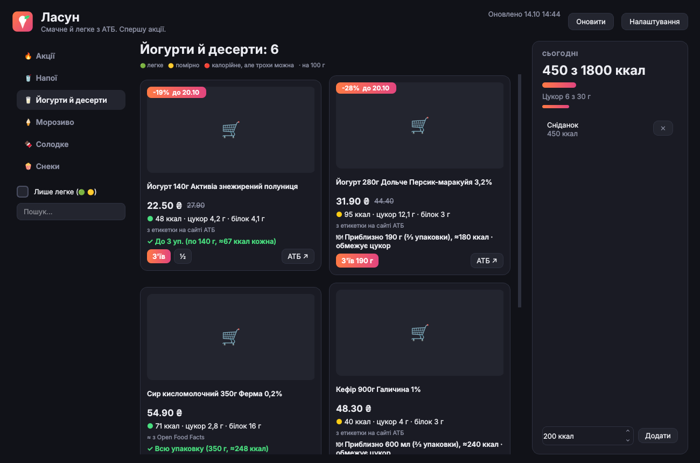

# Lasun (Ласун)

**Tasty, light snacks from the ATB supermarket (atbmarket.com), deals first.** Each card
shows calories and sugar per 100 g and how much of it fits your daily norm right now.
For Linux and Windows 10/11. Nothing to install: a folder with the program.



## Get it

Download from the [latest release](../../releases/tag/latest):

- **Windows:** `Lasun-windows-x64.zip`. Unzip it anywhere (for example to `Documents`),
  open the `Lasun` folder and run **Lasun.exe**. Windows SmartScreen may warn about an
  unknown publisher, because the program is not code-signed: press *More info → Run anyway*.
  On first run Lasun adds itself to the Start menu.
- **Linux:** `Lasun-linux-x86_64.tar.gz`. Unpack it (right-click → *Extract here*), open
  the `Lasun` folder and run **Lasun**. On first run it adds itself to the app menu.

If you move the folder, run Lasun from the new place once and the menu entry follows it.

## How it works

1. Once a day (on start, if the data is older than 18 hours) Lasun reads these ATB sections:
   drinks, yogurts and desserts, ice cream, sweets, snacks. Prices and deals come first,
   in a few minutes; calories take longer, because each product page is read once and
   then kept for 30 days. The first run takes about 15–30 minutes, later ones are fast.
2. Calories and sugar come from the product description on the ATB site. If ATB has
   none, Lasun looks the product up in [Open Food Facts](https://world.openfoodfacts.org)
   by name (marked “≈ from Open Food Facts”, it can be a near match).
3. Ratings per 100 g (drinks per 100 ml):
   - 🟢 light: up to 150 kcal and 5 g sugar (drinks: 20 kcal, 2.5 g)
   - 🟡 moderate: up to 250 kcal and 15 g sugar (drinks: 45 kcal, 6 g)
   - 🔴 heavy: more; shown last, with a small portion.

   Sugar limits follow the UK FSA traffic light (“low sugar” is 5 g per 100 g).
4. “How much” uses your snack budget (default 250 kcal), what is left of the day
   (default 1800 kcal) and the daily sugar limit (default 30 g). Press **Ate it** on a card
   and today's totals update. Change the numbers in **Settings**.

Lasun is a helper, not medical advice. If you watch sugar for a health reason, agree the
numbers with your doctor.

## Where the data lives

- Linux: `~/.local/share/lasun/` (database, image cache), settings in `~/.config/lasun/`.
- Windows: `%APPDATA%\lasun\`, settings in the registry under `HKCU\Software\lasun`.

Delete the folder to remove the program; delete the data folder too to forget everything.

## Run from source

```
python3 -m pip install PySide6-Essentials
python3 lasun.py
python3 -m unittest discover tests
```
